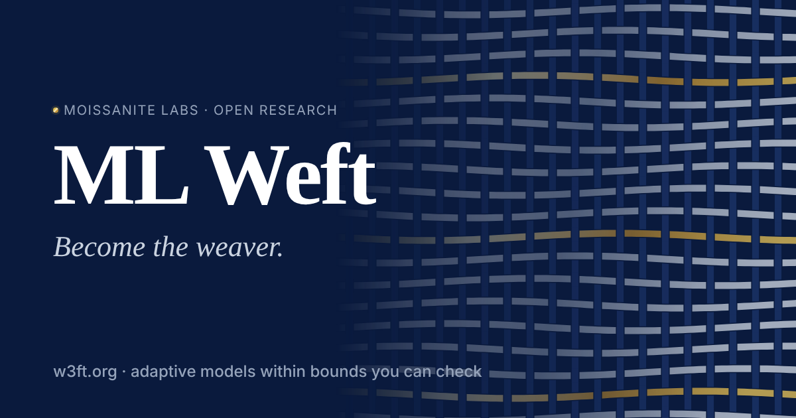

<p align="center">
  <a href="https://w3ft.org"></a>
</p>

<h1 align="center">ML Weft</h1>

<p align="center">
  <em>Become the weaver.</em><br>
  Open research on adaptive models that change themselves within bounds you can check.<br>
  A <strong>Moissanite Labs</strong> project · <a href="https://w3ft.org">w3ft.org</a>
</p>

<p align="center">
  <a href="https://github.com/Moissanite-Labs/weft/actions/workflows/ci.yml"></a>
  <a href="LICENSE"></a>
  <a href="LICENSE-docs"></a>
  
</p>

---

Weft starts from three ideas:

- **Models as cells.** Each model is treated as a cell in a shared memory arena. A cell proposes a cautious and an
  exploratory update, keeps whichever does better on its target, and leaves a frozen core untouched while the edges adapt.
- **Bounds you can check.** A weight update is committed only if it stays within a fixed distance of a saved baseline,
  `‖W − W₀‖_F ≤ R`, and fits its resource budget, `budget ≥ cost > 0`. The same predicate is implemented in Python, C11 and
  JavaScript. Python and JavaScript are tested against one shared vector file, and C11 against hand-written copies of
  the same cases ([#42](https://github.com/Moissanite-Labs/weft/issues/42) unifies them).
- **Interfaces as fields.** [*Eido*](https://github.com/Moissanite-Labs/weft-eido), Weft's design language (internal name *Aywa*), treats visual style as a point in a continuous space and feeds
  the screen small hash-checked lines instead of loose JSON.

Weft began as a long design conversation. That corpus is kept word for word in
[Moissanite-Labs/weft-corpus](https://github.com/Moissanite-Labs/weft-corpus), and this repository turns
it into code that runs, tests that can fail, and documents that say plainly which is which.

> [!IMPORTANT]
> **No token. No sale. Nothing on-chain.** Weft has no coin or token and nothing deployed to any blockchain. The Solidity
> files in [`weft/runtime/ledger/`](weft/runtime/ledger/) are research drafts that run only inside an offline simulator.

## Status

| Component | Path | What it is | Status |
|---|---|---|---|
| C1 · Plasm | [`weft/runtime/plasm`](weft/runtime/plasm) | Shared-memory arena, A/B candidate updates, frozen-core mask, provenance watermark checks | ✅ runs · tested |
| C2 · Invariants | [`weft/runtime/invariants`](weft/runtime/invariants) | The safety gate in Python and C11 (and [JS](site/assets/js/invariant-gate.js)), tested against the same conformance cases | ✅ runs · tested |
| C3 · IC | [`weft/runtime/ic`](weft/runtime/ic) | Interaction-combinator reducer, binary serializer, graph-committed execution record | ✅ runs · tested |
| C4 · Ledger | [`weft/runtime/ledger`](weft/runtime/ledger) | Solidity drafts for provenance, metering and disputes | 📝 draft · not compiled in CI, never deployed |
| C5 · Gateway | [`weft/runtime/gateway`](weft/runtime/gateway) | Offline contract simulator, pure-Python Keccak-256, ABI topic checks | 🧪 simulation only |
| C6 · Telemetry | [`weft/runtime/telemetry`](weft/runtime/telemetry) | Host metrics, 64-byte frames, telemetry-line encoder | ✅ runs · tested (site data is a fixture) |
| C7 · Aywa | [`weft/runtime/aywa`](weft/runtime/aywa), [`site/`](site/) | Weft's field: packet verifier, telemetry worker, WebGPU loom, built on [Eido](https://github.com/Moissanite-Labs/weft-eido) modules | ✅ runs · tested |
| Mac harness | [`weft/runtime/mac`](weft/runtime/mac) | Apple Silicon entry points that wrap C1 and C6 | 🧪 wrappers, no native Metal kernels yet |

**Not built yet:** a bare-metal OS, RTL or FPGA designs, custom silicon, the peer-to-peer mesh, or any deployed governance
system. Each stays a design branch with its own next experiment. See the [convergence plan](docs/program/convergence-plan.md).

## Quick start

You need Python 3.12 or newer, Node 20 or newer, and a C compiler (`cc`, `clang` or `gcc`). Nothing below touches the
network beyond installing packages, and nothing touches a blockchain.

```bash
git clone https://github.com/Moissanite-Labs/weft
cd weft
python3 -m venv .venv && . .venv/bin/activate
pip install numpy torch
```

Run what CI runs:

```bash
python -m unittest discover -s weft/runtime/invariants -p 'test_*.py'   # C2: safety gate, Python + C11
python -m unittest discover -s weft/runtime/plasm -p 'test_*.py'        # C1
python -m unittest discover -s weft/runtime/ic -p 'test_*.py'           # C3
python -m unittest discover -s weft/runtime/telemetry -p 'test_*.py'    # C6
python -m unittest discover -s weft/runtime/gateway -p 'test_*.py'      # C4/C5 simulator
python -m unittest discover -s weft/runtime/aywa -p 'test_*.py'         # C7 (Python)
node --test weft/runtime/aywa/test_*.mjs                                # C7 + site modules
python weft/runtime/aywa/site_selftest.py                               # website bundle
python weft/runtime/core/selftest.py
```

Preview the website locally:

```bash
python3 -m http.server 8000 --directory site
```

Then open <http://localhost:8000>. On a Mac, [`docs/program/use-now.md`](docs/program/use-now.md) explains how to record a
hardware baseline and check whether the MPS backend is actually available.

## Repository layout

```
weft/runtime/        Code: the C1–C7 components and the Mac harness, each with its own README and tests
site/                The w3ft.org website: static, deployed by wrangler.jsonc (site/papers/ is generated)
papers/              The paper series: Markdown sources, experiments, figures and the HTML/PDF templates
docs/                Documentation: mission, roadmap, glossary, interface specs, design notes, the build program
docs/program/        Build program, convergence plan, experiment cards and a file-by-file evidence ledger
docs/corpus/         Claims register, safety index and digests of the source material
scripts/             Corpus audit, site sync and browser tests
```

## How to read this project

Weft uses biological names on purpose: *cells, membranes, mitosis, homeostasis, hippocampal lattice*. They name the
behaviour the design is reaching for. They don't claim the code is biology, or that it has arrived. The project holds
itself to a few rules:

- A **stated** rule is not a **checked** rule. Docs say which predicates the executable path actually enforces.
- A narrated command in the corpus is not evidence that it ran. Evidence is a test in CI or a recorded run.
- Every vision term has a plain description of what the code does today. See the [glossary](docs/glossary.md) and the
  [claims register](docs/corpus/claims-register.md).

## Documentation

- [Mission](docs/mission.md) and [roadmap (four horizons)](docs/roadmap.md)
- **Papers** ([w3ft.org/papers](https://w3ft.org/papers/), source in [`papers/`](papers/)): [Paper 0, overview](papers/00-overview/paper.md), [Paper 1, Models as Cells](papers/01-models-as-cells/paper.md) and [Paper 2, Checkable Computation](papers/02-checkable-computation/paper.md), each as HTML and PDF
- [Glossary](docs/glossary.md)
- [Eido design philosophy](https://github.com/Moissanite-Labs/weft-eido/blob/main/docs/philosophy.md), in the design-language repository
- [Constitution vs. contract](docs/design-notes/constitution-vs-contract.md): where the stated governance and the example contracts disagree
- [I4 shared-memory interface](docs/interfaces/I4-shared-memory.md)
- [Build program](docs/program/build-program.md), [convergence plan](docs/program/convergence-plan.md), [experiment cards](docs/program/experiment-cards.md) and [evidence ledger](docs/program/audit/README.md)
- [Program charter](docs/program/charter.md): the original charter, kept for history

## Related repositories

| Repository | What it holds |
|---|---|
| [weft-eido](https://github.com/Moissanite-Labs/weft-eido) | Eido, the design language: philosophy and dependency-free modules. `site/` vendors four of them. |
| [weft-corpus](https://github.com/Moissanite-Labs/weft-corpus) | The original discovery sessions, verbatim. Corpus paths cited in code and docs here (for example `weft/design/craft.md:136`) refer to that repository. |
| [abios](https://github.com/Moissanite-Labs/abios) | Weft's agent-messaging protocol (SYM-2P). The telemetry line here is an earlier dialect; moving it onto abios is [#67](https://github.com/Moissanite-Labs/weft/issues/67). |

Files under `site/` that come from those repositories are pinned by hash in [`site/VENDORED.json`](site/VENDORED.json).
Update them with `python3 scripts/vendor.py --eido ../weft-eido --corpus ../weft-corpus`.

## Contributing

Contributions that make a claim testable, or show that one is wrong, are the most valuable thing you can send.
Start with [CONTRIBUTING.md](CONTRIBUTING.md). Every commit needs a DCO sign-off (`git commit -s`). Good places to begin:
[#42](https://github.com/Moissanite-Labs/weft/issues/42),
[#43](https://github.com/Moissanite-Labs/weft/issues/43),
[#44](https://github.com/Moissanite-Labs/weft/issues/44),
[#45](https://github.com/Moissanite-Labs/weft/issues/45),
[#51](https://github.com/Moissanite-Labs/weft/issues/51) and
[#52](https://github.com/Moissanite-Labs/weft/issues/52).

Please follow the [Code of Conduct](CODE_OF_CONDUCT.md). Report security issues privately as described in
[SECURITY.md](SECURITY.md).

## License

- **Code** (`weft/runtime/`, `scripts/`, `site/`, `.github/`) is under the [Apache License 2.0](LICENSE).
- **Documentation** (`docs/` and the Markdown files) is under [CC BY 4.0](LICENSE-docs).
  Code listings inside documents may also be used under Apache-2.0.

See [NOTICE](NOTICE) for details and attribution. "ML Weft" and "Moissanite Labs" are names of Moissanite Labs. The
licenses do not grant trademark rights.
