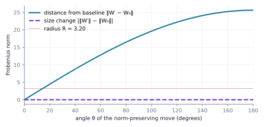
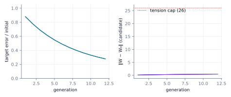
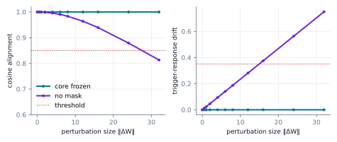
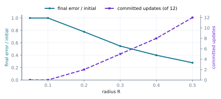

## 1. Introduction

Most deployed models are frozen. They change only when someone retrains or fine-tunes them, and the size of that
change is rarely bounded by anything a program checks. Models that keep adapting online (to a user, a device or a
task) are attractive, but they raise an obvious question: *how far is the model allowed to move, and who checks?*

ML Weft's answer starts from a metaphor and ends in a predicate. The metaphor is that a model is a **cell**. It has a
boundary, a protected core, a limited metabolic budget, and it reproduces by trying out variants and keeping the one
that fits. The predicate is what makes the metaphor accountable. A candidate update $W'$ is committed only if

$$
\lVert W' - W_0 \rVert_F \le R \quad\text{and}\quad b \ge c > 0,
$$

where $W_0$ is a **saved baseline**, $R$ is a fixed radius, $b$ is the remaining budget and $c$ is the cost of the
step. The same predicate is implemented in Python, C11 and JavaScript, and each implementation is tested against
the same conformance cases.

This paper makes four contributions:

1. **A precise statement of the cell contract**: what a cell may change, how candidates are chosen, and the
   conditions under which a candidate is committed (§2–3).
2. **An argument for measuring distance from a fixed baseline** rather than comparing weight sizes or bounding each
   step, with a construction that defeats size comparison exactly (§4).
3. **Experiments that run the tested implementation** (§5): the size-comparison trap, the full cell cycle, a
   watermark threat sweep, a radius sweep, and cross-language conformance.
4. **An honest account of what the experiments do not show** (§6), including three places where the current
   implementation falls short of the design.

The biological names (cell, mitosis, core, membrane, homeostasis) are the project's vision language. They name the
behaviour we aim for. In this paper each one is tied to the specific mechanism that implements it today, and none of
them claims more than that mechanism does.

## 2. The cell

A cell owns one weight matrix $W \in \mathbb{R}^{d \times d}$ inside a fixed shared-memory arena. In the current
implementation `weft/runtime/plasm` sets $d = 256$, and the arena is 540,688 bytes:

| Region | Shape | Bytes | Role today |
|---|---|---:|---|
| Header | u64 + f64 | 16 | generation epoch, tension |
| Focal workspace | float32 [256, 256] | 262,144 | the cell's weights $W$ |
| Sympathetic ring | float32 [1024] | 4,096 | scalar telemetry array |
| Hippocampal lattice | float32 [64, 1024] | 262,144 | a recency buffer used for a novelty term |
| Reserved | bytes | 12,288 | lock storage; no synchronisation protocol yet |

The layout is specified as interface I4. Mapped CPU views share the bytes. Tensor reads copy explicitly, so
"zero-copy" applies to the mapping and not to the whole experiment.

**Core and periphery.** The first $d/4 = 64$ rows of $W$ form the **core**, which is frozen. A plasticity mask $M$ is
zero on core rows. On periphery rows it takes values in $(0, 1)$, scaled down for columns with large magnitude. Every
update has the form $W' = W + \eta\, (M \odot \Delta)$, so core rows cannot change.

**Provenance watermark.** A unit trigger vector $t$ is supported only on core rows, and a target response $y$ has
norm 3. Both are derived deterministically from a seed. Embedding applies a rank-1 correction so that
$W^\top t = y$:

$$
W_0 \leftarrow W + t\,(y - W^\top t)^\top .
$$

Retention is checked on every candidate. The candidate passes if its response $W'^\top t$ has cosine similarity at
least 0.85 with $y$, and its relative drift from the baseline response,
$\lVert W'^\top t - W_0^\top t\rVert / \lVert W_0^\top t\rVert$, is at most 0.35.

**Proposition 1 (periphery updates cannot move the mark).** If $t$ is supported on the core rows and
$\Delta W = M \odot \Delta$ is zero on those rows, then $(W + \Delta W)^\top t = W^\top t$.

*Proof.* $(\Delta W)^\top t = \sum_i t_i\, \Delta W_{i,:}$. Every term vanishes, because $t_i = 0$ off the core and
$\Delta W_{i,:} = 0$ on it. ∎

So under the cell's own update rule, watermark retention is guaranteed by construction. The retention check guards
against *other* writes: updates that skip the mask, and deliberate overwrites (§5.3).

## 3. One generation

Each generation, the cell proposes two candidates (two "lineages") and keeps at most one.

1. **Propose.** With inputs $X$ and target outputs $Y^{\star}$, form the residual direction
   $G = X^\top (Y^{\star} - XW)/n$. The cautious lineage α moves along $0.85\,G + 0.15\,\varepsilon_\alpha$, and the
   exploratory lineage β along $0.5\,G - 0.5\,\varepsilon_\beta$, where $\varepsilon$ is Gaussian noise with
   scale $\sigma$. Both are masked and scaled by $\eta = 0.35$.
2. **Score the exact candidates.** Each candidate is scored as $1/(\lVert XW' - Y^{\star}\rVert_F + 10^{-4})$ plus
   $0.05$ times a normalised novelty term computed from the hippocampal lattice. The score is computed on the very
   matrix that would be committed, not on a proxy.
3. **Gate.** The higher-scoring candidate is committed only if all of the following hold:
   - the distance gate accepts it ($\lVert W' - W_0\rVert_F \le R$ and $b \ge c > 0$);
   - the watermark is retained;
   - the tension bound holds;
   - its target error is no worse than the parent's.

   Only a commit consumes budget ($c = 2.5$, starting budget $100$).
4. **Regulate.** A feedback rule adjusts $\sigma$. If tension is above the band $[15, 35]$, $\sigma$ shrinks by 25%.
   If tension is below the band, $\sigma$ grows by 10%.

In the current code, "tension" is not measured. It is defined as $20 + 2.5\,\lVert W' - W_0\rVert_F$, and the
tension bound requires it to be at most 85. Tension therefore adds a second distance cap of
$(85 - 20)/2.5 = 26$, independent of $R$. We report this because it means the effective radius is
$\min(R, 26)$, not $R$.

## 4. Why measure distance from a fixed baseline

There are three natural ways to bound how much a model changes:

- **Compare sizes:** accept if $\bigl|\lVert W'\rVert - \lVert W_0\rVert\bigr| \le R$. The original design notes did
  this.
- **Bound each step:** accept if $\lVert W' - W\rVert \le r$ relative to the *current* weights.
- **Bound distance from a saved baseline:** accept if $\lVert W' - W_0\rVert \le R$. This is Weft's gate.

**Comparing sizes is not a bound on change.** Two matrices can have identical norms and be arbitrarily far apart.

**Proposition 2.** Let $Q$ satisfy $\langle W_0, Q\rangle_F = 0$ and $\lVert Q\rVert_F = \lVert W_0\rVert_F$, and set
$W_\theta = \cos\theta\, W_0 + \sin\theta\, Q$. Then $\lVert W_\theta\rVert_F = \lVert W_0\rVert_F$ for every
$\theta$, and $\lVert W_\theta - W_0\rVert_F = 2\sin(\theta/2)\,\lVert W_0\rVert_F$.

*Proof.* Expand both norms using $\langle W_0, Q\rangle_F = 0$ and equal norms. The first gives
$\cos^2\theta + \sin^2\theta = 1$ times $\lVert W_0\rVert^2$. The second gives
$(1-\cos\theta)^2 + \sin^2\theta = 4\sin^2(\theta/2)$ times $\lVert W_0\rVert^2$. ∎

At $\theta = \pi$ the candidate is $-W_0$, the furthest point on the sphere, and the size comparison still reports
zero change. Experiment E1 runs exactly this construction.

**Per-step bounds compound.** If each step is limited to $r$ relative to the parent, then after $n$ accepted steps the
model can be $nr$ from where it started. Random steps typically reach $\sqrt{n}\,r$, which still grows without limit.
A bound measured from a fixed $W_0$ composes differently: *every* committed state lies in the ball
$B(W_0, R)$, however many steps were taken.

**Proposition 3.** If every committed candidate satisfies $\lVert W' - W_0\rVert_F \le R$, then every reachable
committed state lies in $B(W_0, R)$, and at most $\lfloor b_0 / c\rfloor$ updates are ever committed.

*Proof.* The first claim is the acceptance condition applied to each commit. Only commits spend budget, by exactly
$c$, and the precondition $b \ge c$ stops commits once the budget runs out. ∎

The price is that the baseline becomes something to protect. If $W_0$ can be rewritten, the bound means nothing. In
Weft the baseline is held outside the update path, and the watermark lives in the frozen core of both $W_0$ and $W$.

## 5. Experiments

All results come from `papers/01-models-as-cells/experiments.py`. The script imports the tested modules in
`weft/runtime/plasm` and `weft/runtime/invariants` and writes `results.json` and the figures. Runs used commit
`a18fc40` on an x86-64 Linux CPU with Python 3.13 and PyTorch 2.15 (CPU build). Each run seeds PyTorch, and the cycle
is forced onto the CPU, so the numbers below are reproducible. Apple MPS results have **not** been measured and are
not claimed.

### 5.1 E1: equal sizes, large moves

We draw $W_0 \in \mathbb{R}^{256\times256}$ with $\lVert W_0\rVert_F = 12.81$, construct $Q$ as in Proposition 2, and
evaluate $\theta = 0°, 5°, \dots, 180°$ (37 cases) with $R = 0.25\,\lVert W_0\rVert_F = 3.20$.



The size change never exceeded $3.4\times10^{-14}$, which is floating-point noise. The measured distance matched the
closed form to within $7.5\times10^{-14}$.

| Check | Accepted | Accepted beyond $R$ |
|---|---:|---:|
| Size comparison $\bigl\lvert\lVert W'\rVert - \lVert W_0\rVert\bigr\rvert \le R$ | 37 / 37 | 34 |
| Weft gate $\lVert W' - W_0\rVert_F \le R$ | 3 / 37 | 0 |

The gate first rejects at $\theta = 15°$, where $2\sin(7.5°) \times 12.81 = 3.34 > 3.20$. This is the same case the
interactive demo on w3ft.org shows with its *Flip signs* button.

### 5.2 E2: the cell cycle

We run the full cycle for 12 generations on each of 10 seeds with the default settings ($R = 120$).



| Measure | Result |
|---|---|
| Runs passing the cycle's own checks | 10 / 10 |
| Final target error ÷ initial | 0.278 mean (0.276–0.280) |
| Core-row drift $\lVert W'_{\text{core}} - W_{0,\text{core}}\rVert_F$ | 0 exactly, in every generation |
| Watermark cosine alignment | 1.0 minimum; response drift 0 |
| Proposals committed | 120 / 120 |
| Lineage chosen | α 120, β 0 |
| Largest distance from baseline | 0.463 |
| Tension range | 20.3–21.2, inside the band, so $\sigma$ was never adjusted |
| Budget | 100 → 70 (12 commits × 2.5) |
| Wall time per 12-generation run | 95 ms median (CPU) |

The cell adapts steadily, and the frozen core and watermark behave exactly as Proposition 1 predicts. The table also
shows what this configuration fails to test. The gate never rejected anything, the feedback rule never acted, and
the exploratory lineage never won. Its update ($0.5\,G - 0.5\,\varepsilon$) is a strictly worse direction than α's
under this score, so selection between lineages is not exercised.

### 5.3 E3: the watermark under attack

We embed the watermark in a fresh matrix and apply perturbations of growing size $\lVert\Delta W\rVert_F$, either
through the mask (periphery only) or to all rows.



Periphery-only perturbations left the response drift at exactly 0 up to $\lVert\Delta W\rVert_F = 32$, as
Proposition 1 requires. Unmasked perturbations were retained up to 12 (cosine 0.964, drift 0.281) and flagged at 16
(drift 0.375). The drift check fires before the cosine check, which first fails at 32 (cosine 0.813).

**Targeted rank-1 overwrite.** An attacker who knows the trigger can replace its response with one of their
choosing, $W' = W_0 + t\,(y_{\text{adv}} - W_0^\top t)^\top$. The watermark check catches this: cosine alignment
drops to −0.04. But the overwrite moves the weights only $\lVert W' - W_0\rVert_F = 4.32$, so **the distance gate at
the default $R = 120$ accepts it.** Distance from the baseline limits *how much* a model changes, not *which
directions* it changes in. Provenance needs its own check, and Weft runs both.

### 5.4 E4: the gate inside the loop

To make the gate bind, we rerun E2 with smaller radii. We report the error of the weights the cell actually *holds*
at the end.



| $R$ | Commits (of 12) | Held error ÷ initial | Largest committed distance |
|---:|---:|---:|---:|
| 0.05 | 0 | 1.000 | 0 |
| 0.10 | 0 | 1.000 | 0 |
| 0.20 | 2 | 0.777 | 0.162 |
| 0.30 | 5 | 0.547 | 0.290 |
| 0.40 | 8 | 0.400 | 0.379 |
| 0.50 | 12 | 0.278 | 0.463 |
| 120 | 12 | 0.278 | 0.463 |

Every committed distance stays below $R$, as Proposition 3 requires. Once a proposal is rejected, the next one starts
from the same weights and the same residual, so the cell stops at the boundary rather than probing past it.

**A reporting defect found by this experiment.** `run_weft_plasm_cycle` reports `final_target_error` from the last
*candidate*, whether or not it was committed. With $R = 0.05$ it reports a ratio of 0.880, a 12% improvement, when no
update was ever committed. With full acceptance the two agree. The table above uses the held weights. The defect is
tracked as [issue #63](https://github.com/Moissanite-Labs/weft/issues/63).

### 5.5 E5: one rule, three languages

The gate's conformance vectors (`weft/runtime/invariants/vectors.json`) contain 6 weight-update cases, 4 tension
cases and 2 metering cases. They include the matching-sizes trap, non-finite candidates, and budget and cost
preconditions. Continuous integration checks all three implementations on every change:

| Implementation | How it is tested | Coverage |
|---|---|---|
| Python reference (`invariants.py`) | reads `vectors.json` | all 12 cases |
| Browser port (`invariant-gate.js`) | reads `vectors.json` | the 6 weight-update cases |
| C11 header (`weft_invariants.h`), built with `-Wall -Wextra -Werror` | hand-written copies of the cases | 5 of the 6 weight-update cases, plus tension and metering checks |

All three agree wherever they are tested. The C test does not yet read the JSON file and does not cover the
non-positive-budget case. Running one corpus across Python and C is tracked as
[issue #42](https://github.com/Moissanite-Labs/weft/issues/42).

## 6. What this does not show

- **Scale.** The cell is one 256×256 linear map fitted to a synthetic target. Nothing here shows behaviour on a
  trained network, a language model, or a real task.
- **Calibration.** The default $R = 120$ is about 260 times larger than any distance the default cycle reaches, and
  the tension cap (26) is 56 times larger. A useful $R$ must be set relative to the task, for example as a fraction
  of $\lVert W_0\rVert$ or from a held-out tolerance. We have not done that yet.
- **Selection.** With one lineage dominating by construction, the A/B mechanism is plumbing rather than evidence of
  selection. A real test needs lineages whose relative merit depends on the data.
- **Tension.** Tension is a function of distance, not an independent measurement of the cell's state, and the
  feedback rule never acted in E2.
- **Adversaries.** The watermark is an integrity check against the cell's own update path and simple overwrites. It
  is not a robust ownership watermark against an adversary who controls training. The distance gate does not stop a
  small, targeted edit (§5.3).
- **Isolation.** Shared memory gives a cell a fixed boundary in bytes. It is not process isolation, and nothing here
  stops another process with access to the mapping from writing to it.
- **Hardware.** No Apple MPS, Metal or other accelerator results are included. The Mac entry points in the repository
  are wrappers around this CPU path.

## 7. Next experiments

1. **Calibrate $R$** relative to task tolerance on a small trained network, and report accuracy against distance.
2. **Real periphery.** Treat low-rank adapters as the periphery and a pretrained model as the core, so the gate
   bounds adapter drift.
3. **Meaningful lineages.** Use two update rules whose ranking changes with the data, and measure selection.
4. **Measured tension.** Derive tension from validation loss or another independent signal, and test whether the
   feedback rule keeps it in band.
5. **Mechanised proof.** Prove Propositions 2 and 3 and the gate's precondition order in Lean, against the
   conformance vectors.
6. **MPS runs.** Repeat E2 and E4 on Apple Silicon, recording device, versions and tolerances.

## Reproducing this paper

```bash
git clone https://github.com/Moissanite-Labs/weft && cd weft
git checkout a18fc40e31e71325aec507258fb80bb26f125c7c
python3 -m venv .venv && . .venv/bin/activate
pip install numpy torch matplotlib
python3 papers/01-models-as-cells/experiments.py      # writes results.json and figures/
python3 -m unittest discover -s weft/runtime/invariants -p 'test_*.py'
python3 -m unittest discover -s weft/runtime/plasm -p 'test_*.py'
node --test weft/runtime/aywa/test_invariant_gate.mjs
```

Wall-clock times will differ by machine. Every other number in §5 should match exactly.

## References

1. ML Weft. *Interface I4: shared-memory layout.* `docs/interfaces/I4-shared-memory.md`.
2. ML Weft. *Claims register* and *safety index.* `docs/corpus/`.
3. ML Weft. *Paper 0: ML Weft, an overview.* <https://w3ft.org/papers/overview/>.
4. Kirkpatrick, J. et al. (2017). Overcoming catastrophic forgetting in neural networks. *PNAS* 114(13).
5. Hu, E. J. et al. (2022). LoRA: Low-rank adaptation of large language models. *ICLR*.
6. Uchida, Y., Nagai, Y., Sakazawa, S., Satoh, S. (2017). Embedding watermarks into deep neural networks. *ICMR*.
7. Mordvintsev, A., Randazzo, E., Niklasson, E., Levin, M. (2020). Growing neural cellular automata. *Distill*.
