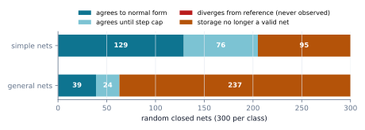
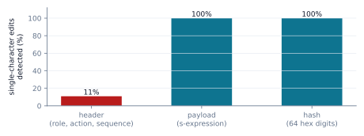

## 1. Introduction

Paper 1 showed how ML Weft bounds *how far* a model may change. This paper concerns a different question: *what did
the system compute, and can someone else check it?* An adaptive system that cannot account for its own computation
is hard to audit, however well its updates are bounded.

Weft's answer has three parts, plus the channel that reports on them:

1. **A computation model made of local steps.** Interaction combinators (Lafont, 1997) compute by rewriting one
   pair of connected nodes at a time. Each step is small, local and has no hidden state, which makes it a natural
   unit to record and re-check.
2. **A canonical binary format** (BCP) for the graphs, so the same graph always has the same bytes.
3. **A committed execution record** that binds the initial graph, the list of steps and the final graph under one
   SHA-256 digest.
4. **A compact telemetry line** with a SHA-256 of its payload, which carries live state to the browser interface.

The code exists and has tests. This paper asks what those pieces actually guarantee. Our main tool is a
**reference semantics**: a separate, deliberately simple implementation that stores every wire as a pair of
*ports*. We run the reducer and the reference side by side and see where they agree. We report four groups of
findings:

- **The rules are right.** The rewrite rules agree with the reference on every case we built, and on every random
  run while the reducer's storage remained a readable graph (§6.1–6.3).
- **The representation is not.** It cannot tell apart two nets that need different rewrites. This is issue #52's
  first falsifier, and we exhibit it.
- **The interface is too permissive.** It reduces pairs that are not active, mishandles wires that loop back into a
  pair, and lets a record omit mutations made between steps. Records are replayable only when every change goes
  through the reducer (§6.4).
- **The formats are robust but limited.** The decoder never crashes, but it validates storage rather than
  structure. The telemetry line's hash does not cover its header and does not authenticate anyone (§6.5–6.6).

As in Paper 1, the biological vocabulary is vision language. In this paper it appears mainly in the "metabolic
valve" node type, and each such term is tied to what the code does.

## 2. Interaction combinators in brief

An **interaction net** is a graph of *agents*. Each agent has one **principal port** (port 0) and a fixed number of
**auxiliary ports**. Every port is joined by a **wire** to exactly one other port. Two agents whose principal ports
are wired together form an **active pair**, and computation consists of rewriting active pairs. Lafont's
*interaction combinators* use three agent kinds: ERA (no auxiliary ports), CON and DUP (two auxiliary ports each).
There are three rule shapes:

- **Annihilation.** Two agents of the same kind disappear, and their auxiliary ports are joined pairwise: port 1 to
  port 1, port 2 to port 2.
- **Commutation.** Agents of different kinds pass through each other. Each is copied twice, and the copies are
  cross-wired.
- **Erasure.** ERA meeting a binary agent deletes it and sends a fresh ERA down each of its auxiliary wires.

Because a rule touches only its two agents, and two active pairs never share an agent, the order in which active
pairs are reduced does not affect the result. Interaction nets are *strongly confluent* (Lafont, 1990).

**Weft's extensions.** Weft adds labels and three agent kinds:

- **Labelled DUPs** (as in symmetric interaction combinators; Mazza, 2007): DUPs annihilate only when their labels
  are equal, and commute otherwise.
- **SUP**, a labelled superposition node that annihilates with a DUP or SUP of the same label.
- **VLV**, a *metabolic valve*. It forwards a wire if a supplied tension is within the C2 bound (0–85) and a
  supplied budget is positive. Otherwise it turns into an excision marker (**FRC**) and erases its neighbour.

The valve is the vision language here. Today it is a predicate on two numbers the caller passes in. It does not
debit a budget, and the budget is a permission signal, not an account. Confluence of the extended system is not
established. The valve in particular makes results depend on inputs supplied at each step.

## 3. The C3 reducer

`weft/runtime/ic` stores a net in three flat, preallocated arrays indexed by **slot**:

- `tags` (u8): the agent kind, with 255 marking a free slot;
- `aux_tags` (i16): the label;
- `ports` (i32 × 3): for each of a node's ports, the **slot of the neighbouring node**, or −1.

The caller drives reduction: `interact(a, b)` applies the rule for the kinds of `a` and `b`, appends a step to the
trace, and returns. Before mutating anything, a rule checks that the arena has the free slots it will need: 2 for
erasure, 4 for commutation, 1 for an excising valve. Exhaustion raises `MemoryError` and leaves the VM unchanged.
The test suite covers this for every allocating rule.

Two properties of this design matter for everything that follows:

- **Ports store a node, not a port.** If node X's port 1 points to Y, the storage does not say *which* of Y's ports
  is at the other end. When X has a single wire to Y, the far port can be recovered by looking at which of Y's ports
  points back. When X has two wires to Y, or a wire to itself, it cannot (Figure 1).
- **`interact` trusts its caller.** It does not check that `a` and `b` are joined principal to principal, and it
  does not detect when an auxiliary neighbour is one of `a` or `b`.


## 4. The binary graph format

A BCP packet is a 12-byte header followed by one 20-byte record per occupied slot, in ascending slot order, all
little-endian:

| Field | Type | Meaning |
|---|---|---|
| magic | 4 bytes | `WEFT` |
| version | u8 | 1 |
| flags | u8 | 0 (canonical active-node snapshot) |
| count | u16 | number of records (at most 65,535) |
| capacity | u32 | arena size in slots |
| *each record:* slot | u32 | slot index, strictly ascending, below capacity |
| tag, reserved | u8, u8 | agent kind 0–5; reserved must be 0 |
| label | i16 | DUP/SUP label |
| p0, p1, p2 | i32 × 3 | neighbour slots, or −1 |

The decoder checks magic, version, flags, exact length, slot order, tags, reserved bytes and port ranges, and
enforces a configurable capacity limit (default 1,048,576 slots). It does all of this **before** allocating the
arena, so a 12-byte packet cannot make it allocate gigabytes.

Because records are in slot order and every field has one valid encoding, a graph state has exactly one encoding:
encode, decode and re-encode reproduces the same bytes. A packet is a *storage snapshot*, not a checkpoint. It does
not carry the allocator cursor or the trace, and it does not check that wires are reciprocal.

## 5. Committed execution records

At the first reduction the VM snapshots the graph as BCP bytes $I$. After a run, `compute_execution_commitment`
serialises the final graph $F$ and the step log $S$ as compact JSON with sorted keys, and returns

$$
C = \mathrm{SHA256}\bigl(\texttt{WEFT-IC-EXEC-V1:} \,\|\, I \,\|\, \texttt{:STEPS:} \,\|\, S \,\|\, \texttt{:FINAL:} \,\|\, F\bigr).
$$

**Proposition 1 (unambiguous encoding).** The map $(I, S, F) \mapsto$ the hashed byte string is injective over
valid BCP packets $I, F$ and JSON arrays $S$.

*Proof.* The prefix is fixed. $I$'s length is determined by its own header ($12 + 20 \cdot \text{count}$). The
separator `:STEPS:` follows at a known offset. A JSON array is self-delimiting, so its closing bracket marks the end
of $S$. After the fixed separator `:FINAL:`, the rest is $F$. Each component can therefore be recovered from the
string. ∎

So two different records with the same commitment would require a SHA-256 collision. The commitment is
**binding**: it pins down exactly one $(I, S, F)$. It does not say the record is *true*. Checking that needs a
**replay**: decode $I$, apply the steps of $S$ in order, and compare the result with $F$. A strict replay also
checks that each step reduced an active pair. The library does not ship a replay verifier yet. We built one for the
experiments.

## 6. Experiments

All results come from `papers/02-checkable-computation/experiments.py`. It imports the tested reducer, codec and
telemetry modules, runs the browser parser under Node, and compares against `reference.py`, about 200 lines in which
every wire is a pair of ports and rewrites contract paths through removed ports. Every random choice is seeded, and
CI re-runs the script to check the numbers below. Before judging anything, the reference checks itself (E0): on 300
random nets it stayed a valid net through all 7,648 reductions, and different reduction orders reached the same
normal form (§6.3).

### 6.1 E1: one rule at a time

We built a minimal closed net for each rule, capping free ends with ERA agents, and compared the reducer's result
with the reference's, up to isomorphism.

| Cases | Matches reference |
|---|---:|
| Annihilation: CON–CON, DUP(0)–DUP(0), SUP(1)–SUP(1), DUP(1)–SUP(1) | 4 / 4 |
| Commutation: CON–DUP, DUP(0)–DUP(1), CON–SUP, CON–DUP with distinguishable neighbours | 4 / 4 |
| Erasure: ERA–CON, ERA–DUP, ERA–ERA | 3 / 3 |
| **Loop-back wires** (an auxiliary port wired into the pair itself) | **3 / 6** |

The loop-back failures are erasure with a self-looped DUP, commutation with a self-looped CON, and commutation with
one wire across the pair. In each case the new nodes point to a slot that the rule then frees. Annihilation handles
all its loop-back cases correctly. This is a defect in the rules, separate from the representation, and is tracked
as [issue #66](https://github.com/Moissanite-Labs/weft/issues/66).

**Falsifier 1 from issue #52.** The two nets of Figure 1 serialise to the **same 132 bytes**, yet the reference
reduces them to non-isomorphic results. The reducer matches the parallel net and gets the crossed one wrong. It has
no way to do otherwise.

### 6.2 E2: differential fuzzing

We generated 600 random closed nets of 4–10 agents (CON, DUP and SUP with two labels, and ERA). In the 300
**simple** nets no agent starts with a self-loop or two wires to the same neighbour, so the initial state is
readable from storage. The 300 **general** nets have no such restriction. For each net we reduced the reducer and
the reference in lockstep, choosing the same active pair. After every step we converted the reducer's storage back
to a port graph and checked that it was isomorphic to the reference.



| | Simple nets | General nets |
|---|---:|---:|
| Agree through to normal form | 129 | 39 |
| Agree until the step or size cap | 76 | 24 |
| Diverge while readable | **0** | **0** |
| Storage stops being a readable net | 95 | 237 |
| … because of repeated wires (ambiguous) | 89 | 211 |
| … because of a stale pointer to a freed slot | 6 | 26 |
| Failing on the initial net | 0 | 192 |
| Median step of failure | 2 | 0 |

Two thirds of simple nets run cleanly. A third reach an ambiguous state after a median of two steps, because
ordinary reductions create repeated wires between agents. Most general nets cannot even be stored faithfully.

### 6.3 E3: does order matter?

For 92 simple nets that reach a normal form within 40 steps, we reduced the reference in 5 random orders each. All
92 reached the same normal form in every order, as strong confluence predicts. The reducer, run in 3 random orders
per net (276 runs), matched that normal form in 189 runs. It became unreadable in 87, and it **never reached a
different readable normal form**. The extended rules (SUP, VLV) are not covered by a confluence result, and VLV
depends on per-step inputs by design.

### 6.4 E4: can a record be replayed?

| Run | Replay reproduces the commitment |
|---|---|
| 60 closed-world runs from E2 (every change made by `interact`) | 60 / 60 |
| The library's own self-test (`run_combinator_self_test`) | **no** |

The self-test snapshots a 4-node graph, then **allocates nodes between steps** outside the trace. Of its 3
recorded steps, **2 are not active pairs**. Its record is binding but not replayable: no verifier could re-derive
its final graph from its initial graph. When we called `interact` on 198 pairs that are not active, the reducer
mutated the net every time, and every time it left storage that no longer describes a valid net. This is issue
#52's second falsifier, confirmed; see also #66.

The lesson is simple and actionable. A record is checkable only if every mutation after the snapshot goes through
the recorded interface, and that interface refuses invalid steps.

### 6.5 E5: decoder fuzzing

From 40 initial graphs we made 20,280 corrupted packets: every single-bit flip at every byte position (twice each,
with random bits), plus every truncation.

| Outcome | Packets |
|---|---:|
| Rejected with `ValueError` | 16,124 |
| Accepted, and re-encoded to exactly the same bytes | 4,156 |
| Accepted, but re-encoded differently | 0 |
| Any other exception (crash) | **0** |
| Accepted, but not a valid net (non-reciprocal or dangling) | 2,671 of 4,156 |

The decoder is robust and canonical. It also does exactly what its documentation says and no more: it validates
storage, not structure. Two thirds of the corrupted packets it accepts no longer describe a valid net, which makes
a structural checker (#52) a necessary companion.

### 6.6 E6: the telemetry line, and abios

Weft's browser field receives lines of the form `:RR:AA:SSSS[s-exp …]<sha256>`: a role byte, an action byte, a
sequence number, an s-expression payload, and the SHA-256 of the payload. This is an early dialect from Weft's design
sessions. The agent-messaging protocol itself is now published as [abios](https://github.com/Moissanite-Labs/abios).
Its normative SYM-2P/1.0 profile is one canonical JSON object per line, with a typed validator. Its v2 draft is a
positional `|`-separated line. Weft's telemetry line is neither, and it is not an abios packet.

**Size.** The figure "101 bytes where the JSON took 481", sometimes quoted for Weft, comes from the abios v2 draft,
which compares its own brief packet with the v1 JSON template. Measured here, Weft's fixture line is **131 bytes**:
an 11-byte header, a 56-byte payload and a 64-character hash. The same content as compact JSON is **177 bytes**.
Most of the line is the hash.

**What the hash catches.** We made five single-character substitutions at every position of the fixture line.



| Region | Edits | Detected |
|---|---:|---:|
| Header: role, action, sequence (11 bytes) | 55 | 6 (11%) |
| Payload (56 bytes) | 280 | 280 (100%) |
| Hash (64 bytes) | 320 | 320 (100%) |

A forged header (`:7f:0a:9999…`) is accepted by both Python and the browser. An attacker who changes the payload
and **recomputes** the hash is also accepted by both. The hash is unkeyed: it detects accidental corruption, not
tampering. abios states the same limit for its own packets (transport signing is open item O-1), and it places
header fields outside the hash by design, enforcing them at publication instead. Weft's line has no such
enforcement. This is tracked as [issue #67](https://github.com/Moissanite-Labs/weft/issues/67).

**Parity.** On 965 lines (valid lines, the mutants above, randomly generated packets and malformed inputs), the
Python codec and the browser parser, run as the telemetry worker uses them, agree on every acceptance decision,
every parsed metric and every header field.

### 6.7 E7: the 64-byte frame

The frame that feeds the shader packs sixteen `float32` values. One of them is a Unix timestamp. At the fixture's
time (1.76 × 10⁹ s), adjacent `float32` values are **128 seconds** apart, so the slot cannot hold anything finer
than about two minutes. The browser worker overwrites that slot with a page-relative clock, which is fine for
animation, but the slot should not be read as wall-clock time.

## 7. What this does not show

- **Correctness of the extended system.** Confluence, termination and any semantics for SUP and VLV are open. Our
  reference mirrors the reducer's own choice for DUP–SUP annihilation; it does not justify that choice.
- **Validity of executions.** A commitment binds a record; it does not prove the record follows the rules. Until
  the reducer rejects non-active pairs and a replay verifier ships, a record proves only that someone wrote it.
- **Scale or performance.** All runs are small nets on a CPU. Nothing here concerns GPU reduction, parallelism or
  allocation-free execution.
- **Universality claims.** Interaction combinators are universal in Lafont's sense. That says nothing about this
  implementation, given the defects above.
- **Authentication.** No component here establishes who produced a graph, a record or a telemetry line.
- **The reference is not a proof.** It is an independent, simpler implementation that agrees with known theory on
  the cases tested. Its own correctness rests on review and on those checks.

## 8. Toward a checkable pipeline

The findings point to a short list of changes, in order:

1. **Port-indexed wires.** Store each port's peer as `(node, port)`, for example as `4·node + port` in the existing
   `i32`. Version the BCP format to 2, with an explicit migration (#52).
2. **A checked interface.** `interact` rejects pairs that are not principal–principal. Rules rewire through a
   path-contraction step like the reference's, so loop-back wires are handled (#66).
3. **Records that cover every mutation.** Freeze the graph after the snapshot except through `interact`, or record
   every allocation as a step. Ship `verify_execution(I, S, F)` in the library, and make the self-test pass it.
4. **Canonical steps across languages.** Specify the step encoding, for example with RFC 8785 JSON
   canonicalisation, so a verifier in another language reproduces $S$ byte for byte.
5. **A structural checker** for decoded packets: reciprocal wires, arity, no dangling ports.
6. **Telemetry on abios.** Move the telemetry line to an abios packet, or at least hash the whole line. Use a keyed
   MAC or signature for anything that crosses machines (#67).
7. **Then, proofs.** Mechanise the rules on the port-indexed representation, and prove that a replay-verified
   record corresponds to a valid reduction sequence.

## Reproducing this paper

```bash
git clone https://github.com/Moissanite-Labs/weft && cd weft
python3 -m venv .venv && . .venv/bin/activate
pip install numpy networkx matplotlib
python3 papers/02-checkable-computation/experiments.py          # writes results.json and figures/
python3 papers/02-checkable-computation/experiments.py --check  # recompute and compare
python3 -m unittest discover -s weft/runtime/ic -p 'test_*.py'
```

Node 20 or newer is needed for the browser-parity experiment. Every number in §6 is deterministic.

## References

1. Lafont, Y. (1990). Interaction nets. *Proceedings of POPL '90*, 95–108.
2. Lafont, Y. (1997). Interaction combinators. *Information and Computation* 137(1), 69–101.
3. Mazza, D. (2007). A denotational semantics for the symmetric interaction combinators. *Mathematical Structures
   in Computer Science* 17(3), 527–562.
4. Lamping, J. (1990). An algorithm for optimal lambda calculus reduction. *Proceedings of POPL '90*, 16–30.
5. NIST (2015). *Secure Hash Standard (SHS)*. FIPS PUB 180-4.
6. Krawczyk, H., Bellare, M., Canetti, R. (1997). HMAC: Keyed-hashing for message authentication. RFC 2104.
7. Rundgren, A., Jordan, B., Erdtman, S. (2020). JSON Canonicalization Scheme (JCS). RFC 8785.
8. abios: the SYM-2P agent-messaging protocol. <https://github.com/Moissanite-Labs/abios>.
9. ML Weft. *Paper 0: overview* and *Paper 1: Models as Cells*. <https://w3ft.org/papers/>.
10. ML Weft issues #52 (valid nets and peer-port topology), #66 (loop-back rewiring and replay), #67 (telemetry
    line integrity).
